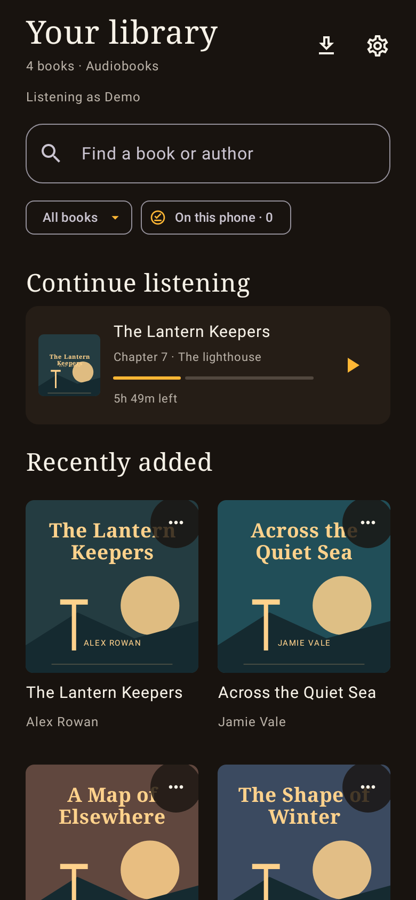
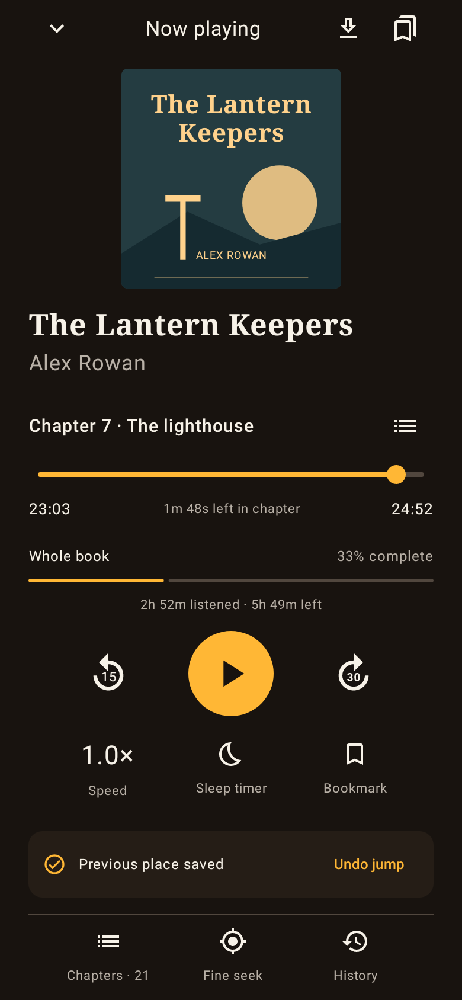
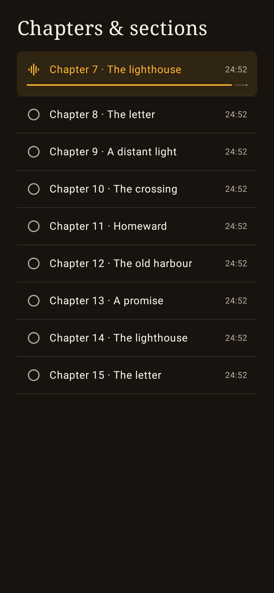

<p align="center">
  
</p>

<p align="center">
  A quiet, thoughtful audiobook player for your own Plex library.<br>
  <strong>Android 8.0+ · Free · No ads · No in-app purchases · MIT licensed</strong>
</p>

<p align="center">
  <a href="https://github.com/smartdevuk/spineplay/releases/download/v0.3.2-beta/Spineplay-0.3.2.apk"><strong>Download the Android APK</strong></a>
  · <a href="https://github.com/smartdevuk/spineplay/releases">All releases</a>
  · <a href="https://github.com/smartdevuk/spineplay/issues">Report a problem</a>
</p>

Spineplay makes long audiobooks easier to live with. See your chapter and whole-book progress separately, make precise jumps, and recover your previous place when a tap takes you somewhere unexpected. Browse another book without it automatically starting to play.

**Early public beta:** the app is actively being tested. Keep a progress backup, particularly before changing installations. It is an independent project and is not affiliated with or endorsed by Plex.

## A look inside

<table>
  <tr><th>Your library</th><th>Your place</th><th>Your chapters</th></tr>
  <tr>
    <td></td>
    <td></td>
    <td></td>
  </tr>
</table>

These screenshots are rendered from the native app using fictional sample books and original code-drawn covers. They contain no real account, server, library or listening-history data.

## Features

- **Find your place:** chapter-relative seeking, whole-book progress, exact-time entry, 15/30-second skips, bookmarks, History and Undo jump.
- **Keep listening simple:** opening a book leaves it paused; explicit Play and Resume buttons start it. A short, silent Spineplay launch animation is skippable.
- **A library that remembers:** Continue listening, search and scroll restoration, newest-first browsing, author and series views, reading-status filters and Listen later.
- **Your Plex setup, remembered:** select your server, permitted audiobook libraries and Plex Home profile once. Change them in Settings.
- **Offline listening:** download whole books, manage their storage and use the On this phone filter. Downloads default to unmetered networks.
- **Better bedtime listening:** per-book speed, smart rewind, a remembered sleep timer, a gentle final fade and a return to the exact place where the timer started.
- **Recovery first:** local checkpoints, durable queued Plex updates, choices when saved places differ, and optional verified folder backups with export/restore.
- **Help for missing chapters:** Plex chapter metadata, published timings for an exact edition through Audnexus, or clearly labelled 15-minute listening sections.

## Install

1. Download **Spineplay-0.3.2.apk** from the [release](https://github.com/smartdevuk/spineplay/releases/tag/v0.3.2-beta) onto your Android phone or tablet.
2. Open the APK and follow Android's prompt to allow installation from the browser or file app you used. Device or organisational restrictions may still apply.
3. Open Spineplay and choose **Sign in with Plex**. Complete sign-in on Plex's website, then return to the app.
4. Choose your Plex Home profile and enter its PIN if required. Choose the audiobook libraries you want to use. A sole available server is selected automatically.
5. Open a book and press **Play**. For backup copies, open **Settings → Enable automatic backups** and choose a folder.

You need an existing Plex account, access to a reachable Plex Media Server and audiobook files in an audio/music library. Spineplay does not include or sell books. Each listener must have permission to access the selected libraries.

### Updates and existing testers

Download future APKs from this repository and install them over the existing app. Updates are currently manual. This beta retains the signing certificate used by the earlier private builds, so existing testers can update in place. Keep the same installation to retain downloads and local records.

Official downloads are attached to [smartdevuk/spineplay releases](https://github.com/smartdevuk/spineplay/releases); each release includes SHA-256 checksums. See [release and signing notes](docs/development.md#release-signing).

## Privacy and your library

- Plex sign-in happens through Plex. Spineplay does not ask for your Plex password. Authorised tokens are encrypted on the device using Android Keystore; a Home profile's PIN is not retained.
- Playback connects to your Plex server. The app has no developer-operated account service, advertising SDK or analytics SDK.
- Chapter lookup is optional. It sends the public edition identifier and region to Audnexus, not your Plex token or audio.
- Progress, bookmarks, cached metadata and downloads live on the phone. Optional backups contain metadata and listening records, without audio or sign-in credentials. Use a backup folder appropriate for your listening history.
- Your Plex server and optional external services handle their own requests and logs. The [privacy notes](docs/privacy.md) describe these flows and local-data removal.

## Current limits

- This is a beta. Real-device checks continue for background playback/downloads, Bluetooth, accessibility, folder providers and simultaneous listening on multiple devices.
- Plex position updates are best effort. Both alternatives are retained when Spineplay detects a conflict, but Plex does not provide an atomic update mechanism for two active devices. Bookmarks and reading flags are not live-synced between phones.
- Published chapter timings must match the recording's edition. Listening sections are navigation aids, not detected book chapters.
- Wait for **Ready offline** before relying on a download. If Android stops an interrupted download service, reopen Downloads and resume it. Reboot-triggered automatic download restart is not implemented.
- Sonos Wi-Fi casting, Chromecast, Android Auto and a home-screen widget are not implemented.
- Spineplay is distributed here as an APK. It is not currently on Google Play or F-Droid. Android's developer-verification rules may add installation requirements in some regions; see [Android's distribution guidance](https://developer.android.com/developer-verification/guides).

## Build and contribute

Use **JDK 17** and **Android SDK 35**. Open the project in Android Studio or use the checked-in Gradle wrapper:

```sh
./gradlew testDebugUnitTest lintDebug assembleDebug
```

On Windows, use `gradlew.bat`. Set your SDK location through `ANDROID_HOME` or an untracked `local.properties` file. Debug builds use your own local signing key and cannot replace the official APK unless their certificate matches.

See the [development guide](docs/development.md), [phone trial checklist](docs/device-trial.md) and [secret-review notes](docs/security-review.md). Public gallery images are reproducible with `PublicShowcaseTest`.

Please report reproducible problems through [GitHub Issues](https://github.com/smartdevuk/spineplay/issues), including your Android version and app version. Remove tokens, account information and private server addresses from logs and screenshots before sharing them.

## Licence and acknowledgements

Spineplay's source is released under the [MIT licence](LICENSE). Dependencies retain their own licences; see [third-party notices](THIRD_PARTY_NOTICES.md). Plex and other referenced product names belong to their respective owners. Audiobooks and artwork from your own library are not part of this project or its licence.
